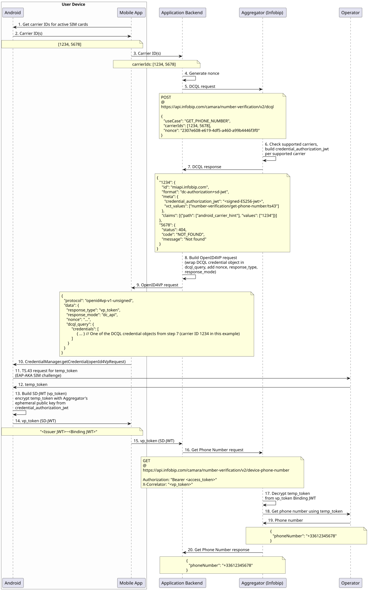
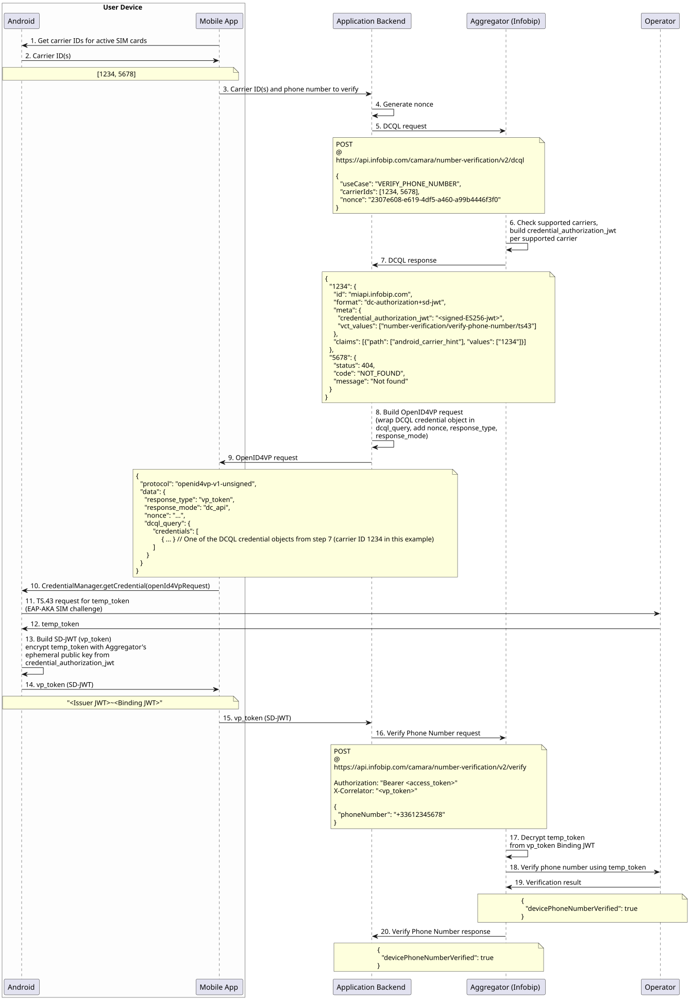

# Number Verification 2.0 — Developer Guide

## Overview

Number Verification 2.0 (NV 2.0) is a GSMA Open Gateway API that lets an application:

- retrieve a subscriber's MSISDN directly from the carrier network
- use the carrier to verify the subscriber's MSISDN.

It is built on the GSMA TS.43 protocol, implemented on Android via
`CredentialManager` and SD-JWT (`vp_token`).

The complete API reference for the endpoints described in this guide is available in the
[Infobip SIM-based Number Verification API docs](https://www.infobip.com/docs/api/connectivity/camara/sim-based-number-verification).

### Architecture

In a production integration all calls to the aggregator (Infobip) are made by the application (Infobip client) backend. The
mobile app collects the carrier IDs and later drives `CredentialManager` on-device, but never calls
the aggregator directly:

```
Mobile App                     Client Backend                    Aggregator (Infobip)
   │                                 │                                    │
   │  1. carrier ID(s)               │                                    │
   ├────────────────────────────────►│                                    │
   │                                 │  2. DCQL request                   │
   │                                 ├───────────────────────────────────►│  /dcql/* endpoint
   │                                 │◄───────────────────────────────────┤
   │  (backend builds OpenID4VP request, hands it to the app)             │
   │◄────────────────────────────────┤                                    │
   │                                 │                                    │
   │  (app passes the request to CredentialManager, receives vp_token)    │
   │                                 │                                    │
   │  3. vp_token                    │                                    │
   ├────────────────────────────────►│                                    │
   │                                 │  4. vp_token                       │
   │                                 ├───────────────────────────────────►│  /device-phone-number
   │                                 │◄───────────────────────────────────┤  or /verify endpoint
   │  5. phone number / verified boolean                                  │
   │◄────────────────────────────────┤                                    │
```

### Glossary

| Term                               | Definition                                                                                                                                                                                                                                                                                                                                                                                                                   |
|------------------------------------|------------------------------------------------------------------------------------------------------------------------------------------------------------------------------------------------------------------------------------------------------------------------------------------------------------------------------------------------------------------------------------------------------------------------------|
| **Infobip (Aggregator)**           | The cloud-side entity that exposes the `/dcql/verify`, `/dcql/device-phone-number`, `/device-phone-number`, and `/verify` endpoints to the application backend, holds the ephemeral private key for JWE decryption, and exchanges the operator's `temp_token` with the operator/carrier.                                                                                                                                                                         |
| **Application**                    | The mobile app plus its backend, together forming the client that initiates the NV flow on behalf of the end user.                                                                                                                                                                                                                                                                                                           |
| **Application backend**            | Mobile application's backend, used for communication with Infobip.                                                                                                                                                                                                                                                                                                                                                           |
| **Mobile app**                     | The mobile app, used as a bridge between the Android and the Application backend.                                                                                                                                                                                                                                                                                                                                            |
| **Operator Token**                 | Android/CAMARA term for the SD-JWT credential (`<Issuer JWT>~<Binding JWT>`) that `CredentialManager` returns as the `vp_token`. It's the transport structure for the operator's `temp_token`: the Issuer JWT (signed by Android Telephony) asserts the credential type and device key binding; the Binding JWT carries the nonce, consent hash, carrier identification, and the `temp_token` itself, encrypted.             |
| **`temp_token`**                   | The GSMA TS.43 Temporary Token issued by the operator's entitlement server (ECS) and handed to the device to be passed to Infobip for authentication on the ECS. Never sent in plaintext — it travels encrypted (JWE, ECDH-ES + A128GCM) inside the Operator Token's Binding JWT, and only the Aggregator can decrypt it.                                                                                                    |
| **`credential_authorization_jwt`** | A JWT signed by Infobip (an ES256 JWS), returned in the `/dcql/*` response's `meta` field. Serves three purposes at once: (1) proves to Android/GMS that Infobip is authorised to request an Operator Token for the SIM's carrier (signature verified against a per-carrier whitelist), (2) carries Infobip's ephemeral public key used later to encrypt the `temp_token`, and (3) carries the consent text shown in the Android system dialog. |
| **NV**                             | Number Verification.                                                                                                                                                                                                                                                                                                                                                                                                         |
| **CAMARA**                         | An open-source global alliance that standardizes network APIs, like number verification, across telecommunications operators.                                                                                                                                                                                                                                                                                                |
| **TS.43**                          | Technical specification that standardizes Service Entitlement Configuration, defining how mobile devices query an operator's server to verify if a subscription is authorized to use specific network services                                                                                                                                                                                                               |
| **DCQL**                           | Digital Credentials Query Language                                                                                                                                                                                                                                                                                                                                                                                           |
| **EAP-AKA**                        | Extensible Authentication Protocol — Authentication and Key Agreement                                                                                                                                                                                                                                                                                                                                                        |
| **ES256**                          | ECDSA using SHA-256                                                                                                                                                                                                                                                                                                                                                                                                          |
| **JWT**                            | JSON Web Token                                                                                                                                                                                                                                                                                                                                                                                                               |
| **SD-JWT**                         | Selective Disclosure JSON Web Token                                                                                                                                                                                                                                                                                                                                                                                          |
| **vp_token**                       | Verifiable Presentation Token                                                                                                                                                                                                                                                                                                                                                                                                |
| **vct_values**                     | Verifiable Credential Type Values                                                                                                                                                                                                                                                                                                                                                                                            |
| **SIM**                            | Subscriber Identity Module                                                                                                                                                                                                                                                                                                                                                                                                   |

---

## 1. Getting the Carrier ID

The carrier ID is an Android-internal integer that uniquely identifies the subscriber's carrier. It
is the primary piece of information the mobile app must collect and forward to the client backend,
which then includes it in a list called `carrierIds` in the request sent to the Infobip's DCQL
endpoint.

---

This approach enumerates every active modem/phone slot rather than assuming a single SIM, so it
works correctly on
dual-SIM and multi-eSIM devices, returning one distinct carrier ID per eligible subscription. No
runtime permission is
required, and no consent prompt or other user-visible indication is triggered before the
CredentialManager step, since
both underlying APIs are permission-free.

```kotlin
fun Context.activeCarrierIds(): List<Int> {
    val telephonyManager = getSystemService(Context.TELEPHONY_SERVICE) as TelephonyManager

    val carrierIds = if (Build.VERSION.SDK_INT < Build.VERSION_CODES.Q) {
        listOf(telephonyManager.simCarrierId)
    } else {
        activeSubscriptionCarrierIds(telephonyManager)
    }

    return carrierIds.filter { it != TelephonyManager.UNKNOWN_CARRIER_ID }.distinct()
}
```

The entry point branches on the Android version: on Android 9 and lower (below Q) it reads the
device's single `simCarrierId`, and on Android 10 and above (Q+) it delegates to
`activeSubscriptionCarrierIds` to enumerate every active SIM. The result is then filtered to drop
`UNKNOWN_CARRIER_ID` and deduplicated.

```kotlin
private fun activeSubscriptionCarrierIds(telephonyManager: TelephonyManager): List<Int> {
    val slotCount =
        if (Build.VERSION.SDK_INT >= Build.VERSION_CODES.R) telephonyManager.activeModemCount
        else @Suppress("DEPRECATION") telephonyManager.phoneCount

    val carrierIds = mutableListOf<Int>()
    for (slot in 0 until slotCount) {
        val subscriptionId = SubscriptionManager.getSubscriptionId(slot)
        if (!SubscriptionManager.isValidSubscriptionId(subscriptionId)) continue

        val telephonyManagerForSubscription =
            telephonyManager.createForSubscriptionId(subscriptionId)
        carrierIds.add(telephonyManagerForSubscription.simCarrierId)
    }
    return carrierIds
}
```

This walks every active modem slot (activeModemCount on Android 11+ (R+), phoneCount before that),
resolves each to a
subscription ID, skips invalid ones, and reads the carrier ID for each valid subscription via
createForSubscriptionId.
On a single-SIM device the loop iterates once, so the result is a single-entry list.

> **Note**: `SubscriptionManager.getSubscriptionId(int)` requires API level 34 (Android 14). On
> lower API levels use `SubscriptionManager.getSubscriptionIds(int)` (available since API level 29)
> and take the first element of the returned array.

---

## 2. End-to-End Integration Flow

This section documents the HTTP calls between the application backend and the Infobip aggregator.
The mobile app's role at each step is summarised briefly; the Android-specific implementation
details for the app side are covered in section 2.2 (CredentialManager).

### Authorization towards Infobip

For all requests towards Infobip, several authorization methods are supported — API Key Header
(`Authorization: App <api-key>`), OAuth 2.0 Bearer token (`Authorization: Bearer <access_token>`),
IBSSO Token Header (`Authorization: IBSSO <token>`), and Basic
(`Authorization: Basic <base64-encoded-credentials>`). The full list and details can be
found [here](https://www.infobip.com/docs/essentials/api-essentials/api-authentication). The
examples below use the API Key header.

### Infobip base URL

For all requests towards Infobip, the examples use `<infobip-base-url>` placeholder. When using this
API, the client should use their personalized base URL. You can learn more about Infobip's
personalized URL's [here](https://www.infobip.com/docs/essentials/api-essentials/base-url#base-url).

---

### 2.1 DCQL Request

> API reference:
> [Number verification DCQL Request](https://www.infobip.com/docs/api/connectivity/camara/sim-based-number-verification/create-verify-dcql-request)

The mobile app collects carrier IDs from the active SIM(s) and sends them to the application
backend. The application backend then requests a DCQL credential authorization from Infobip. In the
request, the application backend sends the list of carrier IDs and a nonce.

The TS.43 use case is selected by the endpoint path:

* `POST /camara/number-verification/v2/dcql/verify` - verify phone number
* `POST /camara/number-verification/v2/dcql/device-phone-number` - get phone number

Both endpoints take the same request body and return the same response.

Breakdown of each body parameter:

* `carrierIds` - array of Android canonical carrier IDs received from the mobile app
* `nonce` - A single-use, application-generated value. The Application keeps it and uses it to
  correlate the eventual
  response. Infobip embeds this same value in the credential_authorization_jwt payload.

**curl:**

```bash
curl -X POST https://<infobip-base-url>/camara/number-verification/v2/dcql/verify \
    -H "Content-Type: application/json" \
    -H "Authorization: App <infobipApiKey>" \
    -d '{
      "carrierIds": [1234, 5678],
      "nonce": "2307e608-e619-4df5-a460-a99b4446f3f0"
    }'
```

**Java:**

```java
private String fetchDcql(List<Integer> carrierIds, String nonce) {
    RequestBody requestBody = RequestBody.create(
            new JSONObject()
                    .put("carrierIds", new JSONArray(carrierIds))
                    .put("nonce", nonce)
                    .toString(),
            MediaType.get("application/json; charset=utf-8")
    );

    Request request = new Request.Builder()
            .url(INFOBIP_BASE_URL + "/camara/number-verification/v2/dcql/verify")
            .header("Authorization", "App " + infobipApiKey)
            .post(requestBody)
            .build();

    try (Response response = httpClient.newCall(request).execute()) {
        return response.body().string();
    }
}

```

#### 2.1.1. Infobip DCQL response

After the request is sent, Infobip will respond with one of the following responses:

##### Map of carrier IDs and DCQL requests for each of those carriers

Infobip will check if any of the carriers in `carrierIds` array are supported and return a map with
a specific response for each carrier. Each key in the map will correspond to one of the carrier IDs
provided in the request. If the carrier is supported and there were no issues, Infobip will return a
DCQL JSON that should be used when requesting credentials from credentials manager on Android. If
the carrier is not supported by Infobip or there were issues generating the DCQL JSON, value in the
map for that carrier ID will contain an appropriate error object with `status`, `code` and `message`
fields.

Example:

```json
{
  "1234": {
    "id": "miapi.infobip.com",
    "format": "dc-authorization+sd-jwt",
    "meta": {
      "credential_authorization_jwt": "<signed-ES256-jwt>",
      "vct_values": [
        "number-verification/verify/ts43"
      ]
    },
    "claims": [
      {
        "path": [
          "android_carrier_hint"
        ],
        "values": [
          1234
        ]
      }
    ]
  },
  "5678": {
    "status": 404,
    "code": "NOT_FOUND",
    "message": "Not found"
  }
}
```

##### Error response when error occurred before resolving carriers

If an error occurs before Infobip can resolve requested carriers, response **will not** contain the
map, but instead, it will contain a single error object with `status`, `code` and `message` fields.
For example, one of the cases where this can happen is if one of the required fields was not sent in
the request.

```json
{
  "status": 404,
  "code": "NOT_FOUND",
  "message": "Not found"
}
```

After Infobip returns a DCQL JSON response, the application backend parses the response, choosing
which DCQL credential
from the map to use, and builds the OpenID4VP request with that credential (see section 2.1.2).
After building the
OpenID4VP request, it hands it to the mobile app, which forwards it unchanged to CredentialManager.
The Android OS then
performs the TS.43 / EAP-AKA SIM challenge and returns a vp_token.

---

### 2.1.2 Building the OpenID4VP Request

The response from the `/dcql/*` endpoint (section 2.1.1) is a map containing DCQL credential objects.
These credential
objects can **not** be passed to `CredentialManager` directly. First, one of those credential
objects must be wrapped
into an OpenID4VP Authorization request.

**Step 1 — build the `dcql_query` object.**
From the Infobip response, extract one of the DCQL credential objects and place the resolved entry
into a `credentials`
array nested under `dcql_query`:

```
"dcql_query": {
 "credentials": [
   {
     "id": "miapi.infobip.com",
     "format": "dc-authorization+sd-jwt",
     "meta": {
       "credential_authorization_jwt": "<signed-ES256-jwt>",
       "vct_values": [
         "number-verification/verify/ts43"
       ]
     },
     "claims": [
       {
         "path": [
           "android_carrier_hint"
         ],
         "values": [
           1234
         ]
       }
     ]
   }
 ]
}
```

**Step 2 — build the OpenID4VP request.**
Wrap `dcql_query` together with a few fixed and per-request fields:

* `protocol` — always `"openid4vp-v1-unsigned"` for TS.43 phone number verification requests
* `data.response_type` — fixed value `"vp_token"`
* `data.response_mode` — fixed value `"dc_api"`
* `data.nonce` — a unique value generated by your backend for each request. **This must be the
  same nonce sent in the original `/dcql/*` request** (section 2.1) — it ties the credential request
  back to the DCQL authorization that produced it, and a mismatched nonce will be rejected.
* `data.dcql_query` — the object built in step 1, specifying which digital credential(s) are being
  requested.

Example:

```json
{
  "protocol": "openid4vp-v1-unsigned",
  "data": {
    "response_type": "vp_token",
    "response_mode": "dc_api",
    "nonce": "2307e608-e619-4df5-a460-a99b4446f3f0",
    "dcql_query": {
      "credentials": [
        /* from step 1 */
      ]
    }
  }
}
```

**Step 3 — wrap the OpenID4VP request in a `requests` array.**
This is the final JSON string passed to `CredentialManager`:

```json
{
  "requests": [
    {
      "protocol": "openid4vp-v1-unsigned",
      "data": {
        "response_type": "vp_token",
        "response_mode": "dc_api",
        "nonce": "2307e608-e619-4df5-a460-a99b4446f3f0",
        "dcql_query": {
          "credentials": [
            /* from step 1 */
          ]
        }
      }
    }
  ]
}
```

Once the OpenID4VP requests array is created, pass it to the mobile app and use it in the call to
`CredentialManager`

---

### 2.2 CredentialManager

The mobile app passes the OpenID4VP request JSON built in 2.1.2 to `CredentialManager`.
The Android OS handles the TS.43 / EAP-AKA SIM handshake internally and returns a response bundle
containing the credential.

**Kotlin (coroutine):**

```kotlin
@OptIn(ExperimentalDigitalCredentialApi::class)
suspend fun requestCredential(activityContext: Activity, dcqlJson: String): GetCredentialResponse {
    val option = GetDigitalCredentialOption(requestJson = dcqlJson)
    val credentialRequest = GetCredentialRequest(listOf(option))
    return CredentialManager.create(activityContext)
        .getCredential(activityContext, credentialRequest)
}
```

Called inside a coroutine:

```kotlin
viewModelScope.launch {
    try {
        val result = requestCredential(activityContext, dcqlJson)
        val vpToken = extractVpToken(result) // see below
    } catch (e: NoCredentialException) {
        // no enrolled SIM
    } catch (e: GetCredentialUnsupportedException) {
        // device/OS does not support NV 2.0
    }
}
```

**Kotlin (callback):**

```kotlin
@OptIn(ExperimentalDigitalCredentialApi::class)
fun requestCredential(
    activityContext: Activity,
    dcqlJson: String,
    executor: Executor,
    onResult: (GetCredentialResponse) -> Unit,
    onError: (GetCredentialException) -> Unit
) {
    val option = GetDigitalCredentialOption(requestJson = dcqlJson)
    val credentialRequest = GetCredentialRequest(listOf(option))

    CredentialManager.create(activityContext).getCredentialAsync(
        activityContext,
        credentialRequest,
        null,
        executor,
        object : CredentialManagerCallback<GetCredentialResponse, GetCredentialException> {
            override fun onResult(result: GetCredentialResponse) = onResult(result)
            override fun onError(e: GetCredentialException) = onError(e)
        }
    )
}
```

Called with:

```kotlin
requestCredential(
    activityContext = activityContext,
    dcqlJson = dcqlJson,
    executor = ContextCompat.getMainExecutor(activityContext),
    onResult = { result ->
        val vpToken = extractVpToken(result) // see below
    },
    onError = { e ->
        // handle GetCredentialException subtypes
        // (e.g. NoCredentialException, GetCredentialUnsupportedException)
        // as shown in the coroutine example above
    }
)
```

The response from the credentials manager should have a structure similar to this:

```json
{
  "protocol": "openid4vp-v1-unsigned",
  "data": {
    "vp_token": {
      "miapi.infobip.com": [
        "eyJhbG...YSGpScQ~eyJhbGc...CD9zg"
      ]
    }
  }
}
```

#### Extracting the vp_token value (SD-JWT)

The `vp_token` value is a single use SD-JWT generated by the OS, that consists of two JWT tokens
separated by a `~` sign. The app should extract this value and send it to application backend which
will then use it in the number verification requests.

> **Note**:
>
> Value of the vp_token can also be extracted in the application backend. It is not mandatory to
> extract it within the app.

To extract the `vp_token` value, navigate to `data` → `vp_token` → the first (and only) entry key
(`"miapi.infobip.com"`) → array index `0` to get the SD-JWT string. Because the entry key itself
contains dots, the code below reads the first entry generically rather than hard-coding the key:

```kotlin
@OptIn(ExperimentalDigitalCredentialApi::class)
fun extractVpToken(result: GetCredentialResponse): String {
    val credential = result.credential as? DigitalCredential
        ?: error("CredentialManager returned a non-digital-credential response")

    val vpTokenObj = Json.parseToJsonElement(credential.credentialJson)
        .jsonObject["data"]
        ?.jsonObject?.get("vp_token")
        ?.jsonObject ?: error("vp_token not found in response")

    return vpTokenObj.entries.first().value.jsonArray[0].jsonPrimitive.content
}
```

---

### 2.3. Number Verification requests (application backend → aggregator)

Once the application backend has the `vp_token` value, it can make the request to Infobip Number
Verification APIs

#### 2.3.1 Get Phone Number

> API reference:
> [Get Phone Number](https://www.infobip.com/docs/api/connectivity/camara/sim-based-number-verification/get-device-phone-number)

The application backend makes a GET http request with `Authorization` and `X-Correlator` headers.

Headers:

- `Authorization` - see [Authorization towards Infobip](#authorization-towards-infobip) section
- `X-Correlator` - `vp_token` (SD-JWT) value received from Android Credential Manager

**curl:**

```bash
curl -X GET https://<infobip-base-url>/camara/number-verification/v2/device-phone-number \
  -H "Authorization: App <infobipApiKey>" \
  -H "X-Correlator: <vp_token>"
```

**Java:**

```java
public String getPhoneNumber(String vpToken) throws IOException, JSONException {
    Request request = new Request.Builder()
            .url(infobipBaseUrl + "/camara/number-verification/v2/device-phone-number")
            .header("Authorization", "App " + infobipApiKey)
            .header("X-Correlator", vpToken)
            .get()
            .build();

    try (Response response = httpClient.newCall(request).execute()) {
        JSONObject result = new JSONObject(response.body().string());
        return result.getString("devicePhoneNumber");
    }
}
```

**Kotlin:**

```kotlin
fun getPhoneNumber(vpToken: String): String {
    val request = Request.Builder()
        .url("$infobipBaseUrl/camara/number-verification/v2/device-phone-number")
        .header("Authorization", "App $infobipApiKey")
        .header("X-Correlator", vpToken)
        .get()
        .build()

    return httpClient.newCall(request).execute().use { response ->
        JSONObject(response.body!!.string()).getString("devicePhoneNumber")
    }
}
```

**Success response (HTTP 200):**

```json
{
  "devicePhoneNumber": "+33612345678"
}
```

**Error response example:**

```json
{
  "status": 400,
  "code": "INVALID_ARGUMENT",
  "message": "Client specified an invalid argument, request body or query param"
}
```

#### Flow diagram



---

### 2.3.2. Verify Phone Number

> API reference:
> [Number Verification](https://www.infobip.com/docs/api/connectivity/camara/sim-based-number-verification/verify-number-v2)

The application backend makes a POST http request with `Authorization` and `X-Correlator` headers
and a `phoneNumber`
parameter in the request body.

Headers:

- `Authorization` - see [Authorization towards Infobip](#authorization-towards-infobip) section
- `X-Correlator` - `vp_token` (SD-JWT) value received from Android Credential Manager

Body:

- `phoneNumber` - Mobile phone number (MSISDN) to verify

**curl:**

```bash
curl -X POST https://<infobip-base-url>/camara/number-verification/v2/verify \
  -H "Content-Type: application/json" \
  -H "Authorization: App <infobipApiKey>" \
  -H "X-Correlator: <vp_token>" \
  -d '{
    "phoneNumber": "+33612345678"
  }'
```

**Java:**

```java
public boolean verifyPhoneNumber(String vpToken, String phoneNumber) throws IOException, JSONException {
    JSONObject body = new JSONObject();
    body.put("phoneNumber", phoneNumber);

    RequestBody requestBody = RequestBody.create(
            body.toString(),
            MediaType.get("application/json; charset=utf-8")
    );
    Request request = new Request.Builder()
            .url(infobipBaseUrl + "/camara/number-verification/v2/verify")
            .header("Authorization", "App " + infobipApiKey)
            .header("X-Correlator", vpToken)
            .post(requestBody)
            .build();

    try (Response response = httpClient.newCall(request).execute()) {
        JSONObject result = new JSONObject(response.body().string());
        return result.getBoolean("devicePhoneNumberVerified");
    }
}
```

**Kotlin:**

```kotlin
fun verifyPhoneNumber(vpToken: String, phoneNumber: String): Boolean {
    val body = JSONObject().put("phoneNumber", phoneNumber).toString()
        .toRequestBody("application/json; charset=utf-8".toMediaType())

    val request = Request.Builder()
        .url("$infobipBaseUrl/camara/number-verification/v2/verify")
        .header("Authorization", "App $infobipApiKey")
        .header("X-Correlator", vpToken)
        .post(body)
        .build()

    return httpClient.newCall(request).execute().use { response ->
        JSONObject(response.body!!.string()).getBoolean("devicePhoneNumberVerified")
    }
}
```

**Success response (HTTP 200):**

```json
{
  "devicePhoneNumberVerified": true
}
```

**Error response example:**

```json
{
  "status": 400,
  "code": "INVALID_ARGUMENT",
  "message": "Client specified an invalid argument, request body or query param"
}
```

#### Flow diagram

